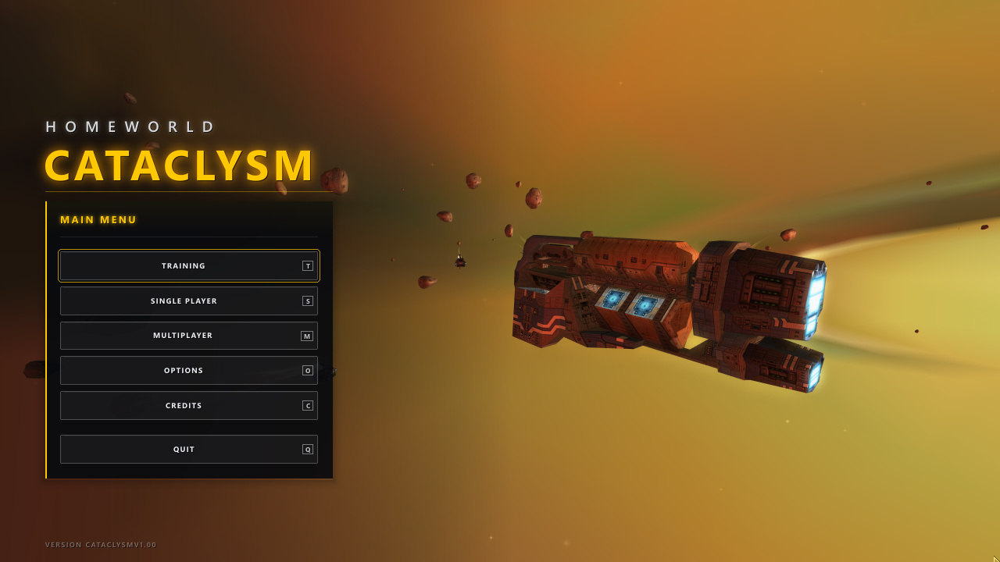
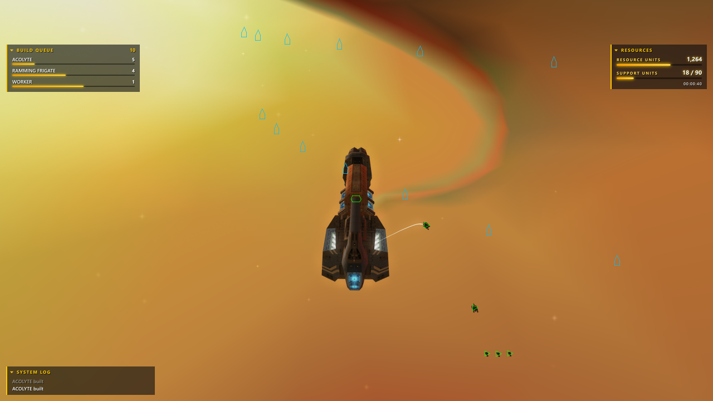
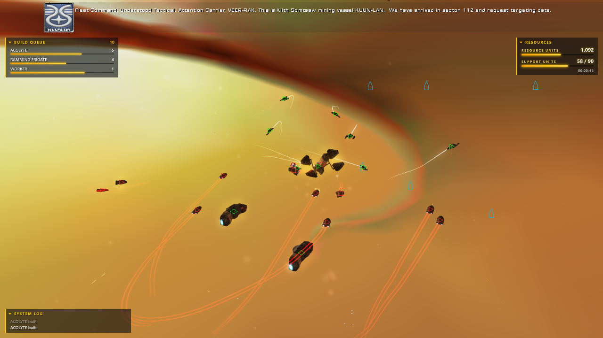
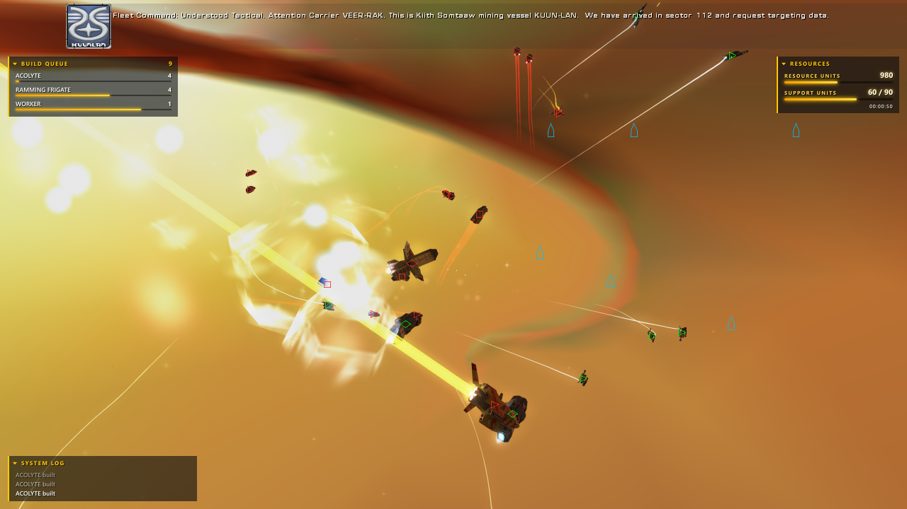
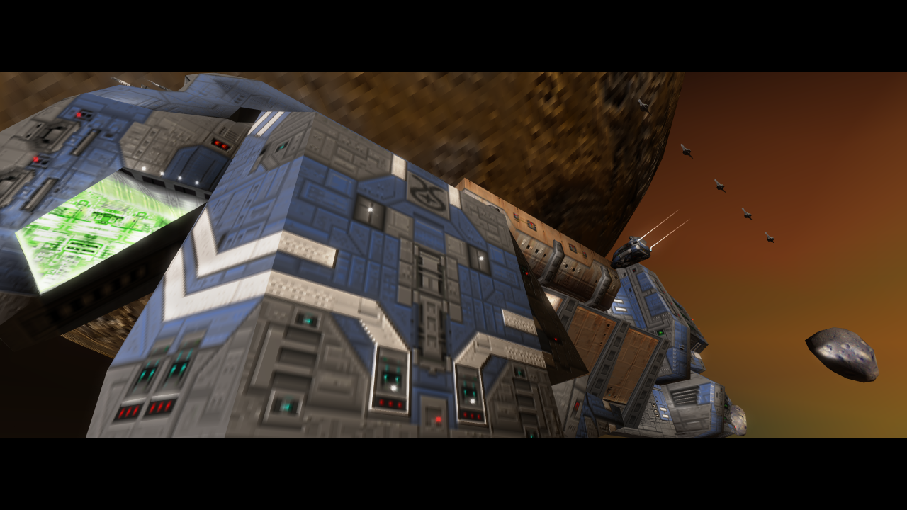
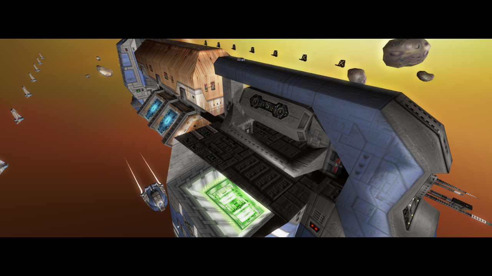
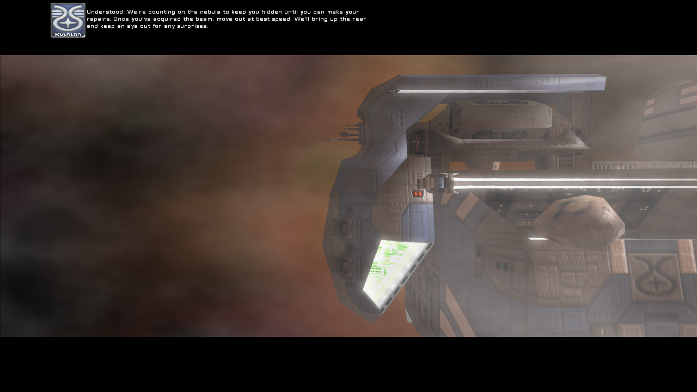

# Homeworld: Cataclysm in Rust

> **Work in progress.** All 17 missions and the tutorial are ported and should play through
> correctly, but so far they have only been tested by hand up to Mission 8. Expect bugs from
> Mission 9 onwards, and please report any you find.

A 1:1 recreation of **Homeworld: Cataclysm** (Barking Dog Studios / Sierra, 2000) in Rust. The
original game's source code was lost; this project rebuilds the game's behaviour from the
original executable, function by function, and runs it on modern Windows with a modern renderer
(wgpu), audio and input, while loading the original game data unchanged.

What works today: the full single-player campaign (all 17 missions and the tutorial, with their
scripts, cutscenes, movies, music and speech), skirmish against computer players, LAN and
internet multiplayer (with a self-hosted lobby server), saved and recorded games, and both the
original interface and an optional modern one.

**You need your own copy of the game.** This repository contains only new Rust code. No original
game data, code or third-party libraries are included: the installer reads them from your own
Homeworld: Cataclysm (or Homeworld: Emergence) install when you set the game up.

## Screenshots

Rendered by the game at 1280x720 with 4x MSAA and 2x supersampling, in its default modern look
(`cargo test --release -p cataclysm readme_shots -- --ignored`). The images are kept on the
repository's `screenshots` branch, not in the code's history.

| | |
|---|---|
|  |  |
| The modern main menu over a live scene | Mission 1: the Kuun-Lan with the modern HUD and ship icons |
|  |  |
| Acolytes and multi-beam frigates against Turanic raiders | The same battle a few seconds on |
|  |  |
| Mission 1's opening cutscene | The Kuun-Lan in the same cutscene |
|  | |
| Mission 6's cutscene in the nebula | |

## Quick install (Windows)

1. Install [Rust](https://rustup.rs) (the installer offers to do this for you through winget).
2. Clone or download this repository.
3. Double-click **`install.cmd`**.

The installer asks for two folders, finding them itself when it can:

| Folder | Needed | What it is used for |
|---|---|---|
| Homeworld: Cataclysm / Emergence install (the folder with `cataclysm.big` and `cataclysm.exe`) | **yes** | all game data, music, speech, movies and mission scripts |
| Homeworld Remastered install (`steamapps\common\Homeworld`) | no | only the optional Homeworld 2 style explosions, engine trails and extra battle chatter |

Both folders are only read, never changed. The installer then builds the game (the first build
takes several minutes), imports the data into `game\data`, and creates `game\Play Cataclysm.cmd`
and a desktop shortcut.

## Requirements

* Windows 10 or 11, 64-bit.
* A GPU with Direct3D 12 or Vulkan support (integrated graphics such as Intel UHD 750 is enough).
* The latest stable Rust (`rustup` installs it), with the MSVC toolchain and the Visual
  Studio C++ build tools (`rustup` offers to install them).
* About 1 GB of disk for the imported data and 3 GB for the build.
* Homeworld: Cataclysm, the 2000 retail release. The importer checks the executable against
  the known retail build; other builds (such as the Homeworld: Emergence re-release) are
  imported with a warning and are untested.
* Optional: Homeworld Remastered Collection (Steam).

## Setup for AI agents and scripts

Everything below runs unattended. Run it from the repository root in PowerShell.

```powershell
# 1. Toolchain check (install Rust from https://rustup.rs if this fails).
cargo --version

# 2. Build, import and create the launcher, without any dialogs.
#    -CataclysmDir is optional when the install is in a standard Steam, GOG or Sierra location.
#    Add -RemasteredDir "<...\steamapps\common\Homeworld>" to import the optional effects,
#    or -NoRemastered to skip them.
powershell -NoProfile -ExecutionPolicy Bypass -File .\install.ps1 -NonInteractive `
    -CataclysmDir "C:\path\to\Homeworld Cataclysm" -NoRemastered

# 3. Run.
.\game\cataclysm.exe .\game\data
```

`install.ps1` exits with code 0 on success and 1 on any failure, with an `ERROR:` line saying
what is wrong. Other switches: `-InstallDir <dir>` (default `.\game`), `-SkipBuild` (reuse
`target\release`; honours `CARGO_TARGET_DIR`), `-Verify` (re-hash and parse-check every
imported file), `-NoShortcut`, `-Launch`.

The same steps by hand:

```powershell
cargo build --release -p cataclysm -p hwc-import
.\target\release\hwc-import.exe "C:\path\to\Homeworld Cataclysm" .\game\data
# optional effects (can also be run later, on its own):
.\target\release\hwc-import.exe --hwr "C:\...\steamapps\common\Homeworld" .\game\data
.\target\release\cataclysm.exe .\game\data
```

Notes for agents:

* Never write into the original game folders; the importer refuses an output folder inside the
  install.
* `game\`, `target\` and imported data are git-ignored. Never commit original game files
  (`*.big`, `*.bik`, `*.vce`, `*.wxd`, `*.exe`, `*.dll`) or screenshots of the original's art.
* Quick smoke test after installing: `.\game\cataclysm.exe .\game\data --skip-intro --exit-after 20`
  should open a window at the main menu and exit with code 0 after 20 seconds.
* Tests: `cargo test --release`. Tests that need the game data read `HWC_GAME_DIR` (the
  original install) and skip when it is not set; tests marked `#[ignore]` render screenshots
  or play long games and are run on purpose with `-- --ignored`.

## Running the game

```text
cataclysm.exe [data dir] [options]
```

The data directory defaults to `%HWC_DATA_DIR%`. Useful options:

| Option | Effect |
|---|---|
| `--window` / `--fullscreen` / `--borderless` | display mode (borderless is the default) |
| `--size 1920x1080` | resolution for this run |
| `--skip-intro` | start at the main menu |
| `--front-end original` | the original main menu instead of the modern one |
| `--hud original` | the original in-game HUD |
| `--no-sound` | no audio device |

`cataclysm.exe --help` lists everything. Settings are saved in `<data>\config\hwc-options.cfg`;
most enhancements can be switched on and off in game under **Options > Enhancements**. Saved
games are in `<data>\saves` (or `%HWC_SAVE_DIR%`).

Where the game differs from the original by default (borderless window, modern HUD and menus,
full-detail ships, modern graphics, right-click to move), the original behaviour is one option
away, and each difference is listed in `cataclysm.exe --help` as "a user-requested change".

### Quality-of-life changes and enhancements

On top of the 1:1 recreation, the game has a set of modern conveniences. Each one can be
switched off to get the original behaviour back, in game under **Options > Enhancements**, on
the command line, or in `hwc-options.cfg` (the setting's name is given in brackets).

**Controls and camera**

* **Ship icons** in the style of the later Homeworld games, over every ship or only distant
  ones. **Tab** cycles them; Shift+Tab is the original's ship info (`hwcShipIcons`,
  `hwcTabShipIcons`).
* **Move wheel on right-click:** with ships selected, a right click on empty space opens the
  move plate; Shift+right-click opens the original's menu (`hwcRightClickMove`).
* **Order lines** from the selected ships to their targets and destinations, coloured by order
  (`hwcOrderLines`), and outlined health bars (`hwcHealthBrackets`).
* **Double-click a ship** to select every ship of that type on screen (`hwcDoubleClickSelectType`).
* Smooth mouse-wheel zoom (`hwcSmoothZoom`); Alt+click focus keeps the current zoom
  (`hwcAltFocusKeepsZoom`); the camera can't zoom inside a hull (`hwcZoomClear`).
* The sensors manager follows the main view's focus, and F centres it on the selection
  (`hwcSensorsFollow`, `hwcSensorsFocusStays`).
* Quick save and quick load on Shift+F5 / Shift+F9 (`hwcQuickSave`, off by default).
* Optional formation focus fire: wingmen always fire at the leader's target
  (`hwcFormationFocusFire`, off by default).

**Interface**

* **Modern HUD:** resources and selected ships top right, objectives and build queue top left,
  system log bottom left, each panel collapsible. `--hud original` or `hwcModernHud = 0`
  restores the original HUD (and with it the original managers).
* **Modern managers and menus:** the build, research and launch managers and the in-game
  menus redrawn in the same style (`hwcModernBuildManager`, `hwcModernResearchManager`,
  `hwcModernMenus`).
* **Modern main menu** over a live in-engine scene of the Kuun-Lan with its workers
  harvesting (`hwcModernFrontEnd`, `--front-end original`).
* Borderless full-screen window by default, any resolution up to 5120x1440, Alt+Enter to
  switch modes (`hwcDisplayMode`).
* Cutscene letterbox bars no thinner than on a 4:3 screen (`hwcOriginalLetterbox`).
* Optional spoken battle reports in campaign games (`hwcBattleReports`, off by default).

**Graphics**

* Ships drawn at full detail at any distance (`hwcFullDetailShips`).
* Modern ship lighting: per-pixel light and highlights, smoothed facets, sky light, ambient
  occlusion, shadows, tone mapping, bloom and heat haze (`hwcShipLook`, `hwcSkyLight`,
  `hwcAmbientOcclusion`, `hwcShadows`, `hwcToneMap`, `hwcBloom`, `hwcHeatHaze`).
* Smooth engine trails, and engine glows that keep their size relative to the hull
  (`hwcSmoothTrails`, `hwcGlowsInProportion`).
* Redesigned Sentinel force fields: a shimmering hex bubble that ripples where it is hit
  (`hwcModernFields`).
* Anti-aliasing: MSAA up to 8x, supersampling up to 2x and FXAA (`hwcMsaa`, `hwcRenderScale`,
  `hwcFxaa`; off by default).
* Optional, from your own Homeworld Remastered install: Homeworld 2 style ship explosions and
  engine trails (`hwcRemasteredFx`), and Remastered battle chatter for the lines Cataclysm has
  none of (`hwcRemasteredChatter`). Both are off by default.

**Multiplayer and saves**

* LAN and internet play without the original's WON servers, through a lobby server anyone
  can run (`hwc-lobby`).
* Skirmish games can be saved, and any skirmish or network game can be recorded and played
  back.

### Multiplayer

LAN games find each other automatically (UDP port 28471, game port 28470). For internet games
one player runs the lobby server, `hwc-lobby.exe` (`cargo build --release -p hwc-lobby`, TCP
port 28472), and everyone sets `hwcLobbyServer = <address>:28472` in their options file or the
`HWC_LOBBY` environment variable. All players need the same build.

## Repository layout

| Path | Contents |
|---|---|
| `apps/cataclysm` | the game executable |
| `apps/hwc-import` | the importer: builds the data directory from your install |
| `apps/hwc-lobby` | lobby server for internet games |
| `apps/hwc-viewer` | ship and effect viewer (development) |
| `apps/hwc-tools` | archive and format tools (`big-extract` etc.) |
| `crates/hwc-formats` | the original file formats (`.big`, `.geo`, `.lif`, scripts, ...) |
| `crates/hwc-sim` | the simulation: ships, AI, combat, missions, multiplayer rules |
| `crates/hwc-kas` | the mission scripting language, extracted from `cataclysm.exe` |
| `crates/hwc-render`, `hwc-fx` | renderer and effects |
| `crates/hwc-ui` | menus, HUD and managers, original and modern |
| `crates/hwc-audio`, `hwc-video` | sound, music, speech; Bink movie decoder |
| `crates/hwc-nis` | in-engine cutscenes |
| `crates/hwc-net` | lockstep networking, LAN and internet lobby |
| `crates/hwc-hwr` | optional Homeworld Remastered effects import |
| `docs/` | format notes, design notes, parity tracking (`docs/PLAN.md`, `docs/parity.md`) |
| `install.cmd`, `install.ps1` | the installer |

## Status and fidelity

The aim is behaviour identical to the original, checked against the original executable: the
same simulation update for update, the same scripts, the same numbers. Deliberate differences
are opt-out options. Known gaps are tracked in `docs/parity.md` and `docs/fleet-audit.md`.

## Legal

Homeworld and Homeworld: Cataclysm are trademarks of their owners. This is an unofficial,
non-commercial fan project, not affiliated with or endorsed by them. It contains no original
game assets or code; you must own the game to play. The project's own code is licensed under
MIT or Apache-2.0, at your option.
